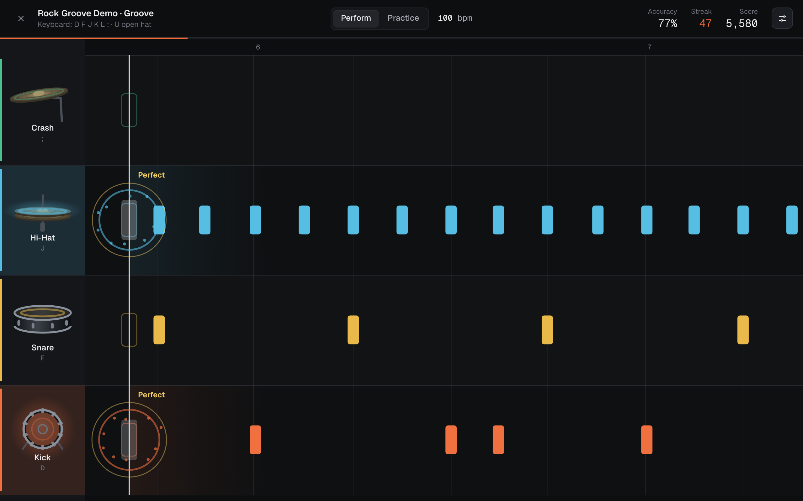
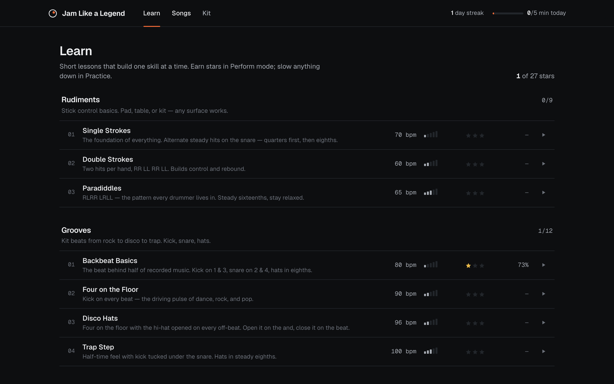
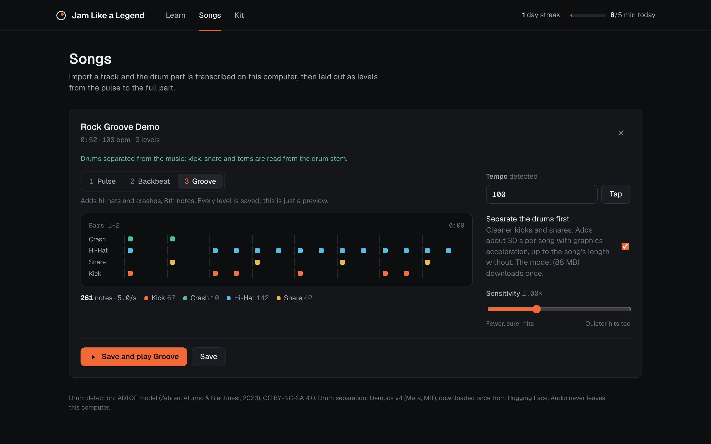
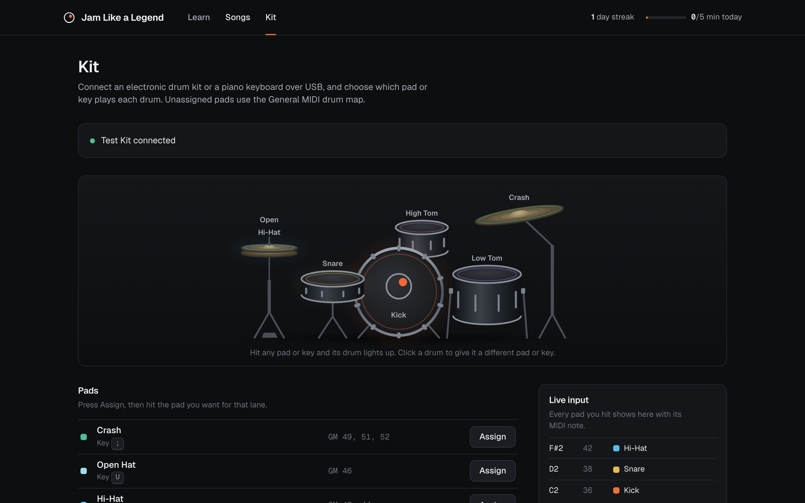

# Jam Like a Legend

An [Attune LLC](#license) product, open source under the MIT license.

A drum trainer for electronic kits: guided lessons (rudiments, grooves, fills),
USB/MIDI kit input with per-pad mapping, and **your own songs as playable drum
charts**. Drop in an MP3 and the drum part is transcribed in the browser:
kick, snare, hi-hat, toms and cymbals, on the song's own beat, at up to five
difficulty levels.

## What it does

**Play along.** Each drum has its own row, and its notes move toward a hit
line. Hit the pad as a note arrives and the hit is graded, from Perfect down
to a miss. Accuracy, streak and score are at the top of the screen.



**Learn one skill at a time.** Nine short lessons cover rudiments, grooves
and fills. Perform mode earns up to three stars a lesson; Practice mode slows
anything down.



**Turn your own songs into drum charts.** Import an MP3, M4A, WAV or OGG file
and the drum part is written out for you, from a simple pulse up to the full
part. The audio never leaves your computer.



**Use the kit you have.** An electronic drum kit or a piano keyboard over USB,
or the computer keyboard. The Kit page shows which pad plays which drum and
lets you change it.



The track in these screenshots is one of the project's own synthetic test
mixes (`bench/songs.ts`), and the kit is the test suite's simulated one.

## Run it

```bash
npm install
npm run dev        # http://localhost:5173
```

Needs [Node.js](https://nodejs.org) 20.19 or newer (`npm` comes with it).

Plug the kit in over USB before opening the page (Chrome or Edge, which have
Web MIDI). Kit setup maps pads to lanes; keyboard fallback is D F J K L ;, with
U (above J) for the open hi-hat.

On the play screen each chart row's label draws its drum (hi-hat, snare, kick,
high and low tom, crash), right beside the notes it plays: the drum lights in
its row's colour when hit, its ring glows as its next note comes up, and it
rings red on a miss. Click a row's drum to play it. The whole kit, drawn, is on
the Kit page, and "Show the drum kit" in the play screen's settings puts it
under the chart as well (off by default). The open hi-hat is its own
instrument on the same stand: an open hit lifts the top cymbal and rings for
most of a second, and the next closed hit chokes it, as on a real kit. Open and closed hats share the
hi-hat's chart row, as in drum notation: a closed hat is a solid note, an open
hat a hollow one with an "o" in it, and the row's label shows both notes with
their keys when a lesson (such as Disco Hats) opens the hat. General MIDI note
46 plays it. Song charts have one hi-hat (the transcription can't tell open
from closed), so an open hit also counts for a hi-hat note; an open-hat note
needs the open hat. Each pad hit lights its drum, brighter for harder hits.
On the Kit page, click a drum and hit a pad to assign it.

A USB piano keyboard plays the drums too, the same way in every octave:

| Key | C | C# | D | D# | E | F | F# | G | G# | A | A# | B |
|---|---|---|---|---|---|---|---|---|---|---|---|---|
| Drum | kick | crash | snare | crash | snare | low tom | hi-hat | low tom | hi-hat | high tom | open hat | high tom |

It follows General MIDI's drum octave where the two agree (C kick, D snare,
F#/G# hi-hat, A# open hi-hat, C# crash, D# ride). Notes on channel 10, the drum channel,
keep the drum map, so drum kits and the drum pads on keyboards work as before;
notes on any other channel use this layout. The Kit page draws the octave,
moves a drum to another key (click the drum, then press the key, on the
keyboard or the drawing), and can mark a device as a drum kit if a kit sends on
another channel. After you play a piano key, the drums and chart rows show
piano notes instead of D F J K L ;, until you press a computer key again.

## How song charts are made

`src/engine/chart/`

0. **Drum separation** (on by default, "Separate the drums first" on import):
   Demucs v4 (`htdemucs_ft` drums specialist, Meta, MIT) separates the drums
   from the music, and kick, snare and toms are read from that drum stem,
   where guitars, bass and vocals cannot pass for drums. Hi-hats, cymbals,
   tempo and bars still come from the full mix, where cymbal attacks are
   intact (`mergeStem` in `pipeline.ts`). The import preview appears from
   the full mix in seconds and sharpens when separation is done; a song saved
   earlier is updated when it finishes. Re-chart separates existing songs.
   - Model: `htdemucs_ft_drums_safe16.onnx` (88 MB, an onnxruntime-web
     export by monteslu/htdemucs-ft-webgpu on Hugging Face), downloaded once,
     checked against its SHA-256 and kept in Cache Storage. Dev builds use
     `local/models/demucs/` first if it holds a copy.
   - The ONNX graph is the network only; `demucs.ts` does Demucs' own
     spectrogram and inverse (exact to 160 dB, `bench/demucs.test.ts`) and
     the 7.8 s overlapping segments.
   - Speed: on WebGPU about 0.9 s per 7.8 s segment (a 2:35 song imported,
     separated and charted in 30 s on an M-series Mac). The model is fp16 and
     two parts of it break on WebGPU (the input normalization overflows; the
     time decoder's 1-D transposed convolutions come out wrong), so those 20
     nodes run on the CPU (`DEMUCS_CPU_NODES`), and on first use the worker
     checks one test segment on GPU and CPU and only uses the GPU if they
     agree. Without a usable GPU: CPU with 8 threads, about real time.
     The worker uses onnxruntime-web's WebGPU build for both models (its
     wasm is 6.9 MB gzipped, 3.3 MB more than the CPU-only one; fetched once,
     when a song is first imported).
     Threads need cross-origin isolation, which `vite.config.ts` turns on
     (COOP same-origin, COEP credentialless); any host serving Jam Like a Legend needs
     the same two headers.
   - Measured: on the test songs, kick 100, snare 98→99, hi-hat 96, crash
     95 (stem alone loses cymbals: crash 81). In In The End's verse the
     stem finds the second kick of every bar that the full mix dropped in 5
     of 8 bars. `npx tsx bench/run.ts hybrid` (needs the local model),
     `bench/stem-songs.ts` and `bench/compare-bars.ts` compare real songs.
1. **Drum model**: ADTOF Frame_RNN (CNN + 3 bidirectional GRUs) turns a
   log-filtered spectrogram (100 frames/s, 84 bands) into per-frame
   probabilities for kick, snare, tom, hi-hat, cymbal. It runs with
   onnxruntime-web in a Web Worker: about 5 s for a 4-minute song.
   The conv front end runs in chunks (it only sees ±4 frames); the recurrent
   back end runs over the whole song, so output matches the reference model
   to 1e-6.
2. **Peaks**: madmom-style peak picking with the model's published per-class
   thresholds; toms split high/low by pitch.
3. **Beats**: tempo from an autocorrelation comb over the drum activity,
   beats by dynamic programming (Ellis 2007), bar starts from kick/crash on
   1 and the backbeat on 2 and 4.
4. **Arrangement**: notes snap to a 16th grid built from the tracked beats,
   one per lane per slot, at most two hand drums at once.
   **Repeated bars agree**: soft notes near the threshold flicker in and out
   from bar to bar, so the bars that repeat a bar's groove (same confident
   notes) decide its uncertain notes together, by their average strength.
   Two-bar patterns, pickups at the same place in every 4-bar phrase, loud
   one-offs and fills are left alone (`bench/vote-check.ts` checks every
   decision against the test songs' exact parts: no real note dropped).
   `bench/consistency.ts song.mp3` measures how often a real song's bars
   repeat exactly.
5. **Levels**: every saved song keeps its analysis, and each level is
   arranged from it on demand, each one containing the level below:
   1 Pulse (kick + snare on the beat), 2 Backbeat (kick + snare on 8ths),
   3 Groove (+ hats and crashes, 8ths), 4 Full kit (16ths, toms, fills),
   5 Master (+ ghost notes). A level adding under 5% more notes than the one
   below is hidden. Stars are tracked per level; the song card suggests the
   first level without stars, and results offer the next level.

## Timing

Songs and lessons run on one rule: the game clock is the audio render clock
minus the output latency (what reaches your ears), so notes, clicks and
judging all line up with what you hear, at any practice tempo. Songs use the
backing track's playhead; lessons the audio clock, with count-in and
metronome clicks scheduled ahead on the audio clock (beat-tracked songs click
on their tracked beats). Hits are judged at the input event's own timestamp
(keyboard, pads, MIDI), not when the page got round to handling it, and hits
during the count-in count.

Output latency defaults to what the device reports. If your speakers or
headphones add more, the results screen notices a steady early/late lean and
offers to shift timing by that amount (☰ Menu → Audio sync to adjust).

`e2e/timing/` holds the robot drummer that checks all of this in a real
browser by hitting notes when their sound reaches the speakers.

## Chart quality bench

```bash
npm test           # regression test (fails if quality drops)
npm run bench      # per-song table: old generator vs current
npx tsx bench/tab.ts song.mp3 8 8   # print a real song's chart as drum tab
```

Six synthetic full mixes with exact drum parts (rock, four-on-the-floor,
swung hip-hop, half-time metal, funk with ghost notes, ride ballad), scored
per lane at ±50 ms:

| generator | kick | snare | hi-hat | cymbal | overall F |
|---|---|---|---|---|---|
| original (band thresholds) | 43 | 31 | 0 | 0 | 25 |
| ADTOF + beat grid (current) | 100 | 99 | 95 | 91 | 96 |

All six tempos are detected correctly; mean timing offset is −3 ms.

## License

Jam Like a Legend is an Attune LLC product. Its source code is open source
under the [MIT license](LICENSE), copyright © 2026 Attune LLC.

**The drum model is not MIT.** The drum model is **ADTOF** by Mickaël Zehren, Marco Alunno and Paolo
Bientinesi ("High-Quality and Reproducible Automatic Drum Transcription from
Crowdsourced Data", *Signals* 2023), via the PyTorch port by Xavier Riley
(github.com/xavriley/ADTOF-pytorch). The weights are licensed
**CC BY-NC-SA 4.0: non-commercial use only.** `public/models/*.onnx` are a
format conversion of those weights and carry the same license
(`public/models/README.md`). Because of that model, the app as shipped is for
non-commercial use: before Jam Like a Legend is sold or used commercially, the
model has to be replaced or licensed.

The other third-party work the app uses (the Demucs separation model,
SoundTouchJS, ONNX Runtime, React, the Geist fonts) is listed in
[THIRD_PARTY_NOTICES.md](THIRD_PARTY_NOTICES.md).

To regenerate the ONNX files: clone the port, then

```bash
python -I tools/adtof_export.py <ADTOF-pytorch checkout> <out dir> [reference.wav …]
npx tsx bench/adtof-check.ts <out dir> reference.wav   # TS port vs PyTorch
```
